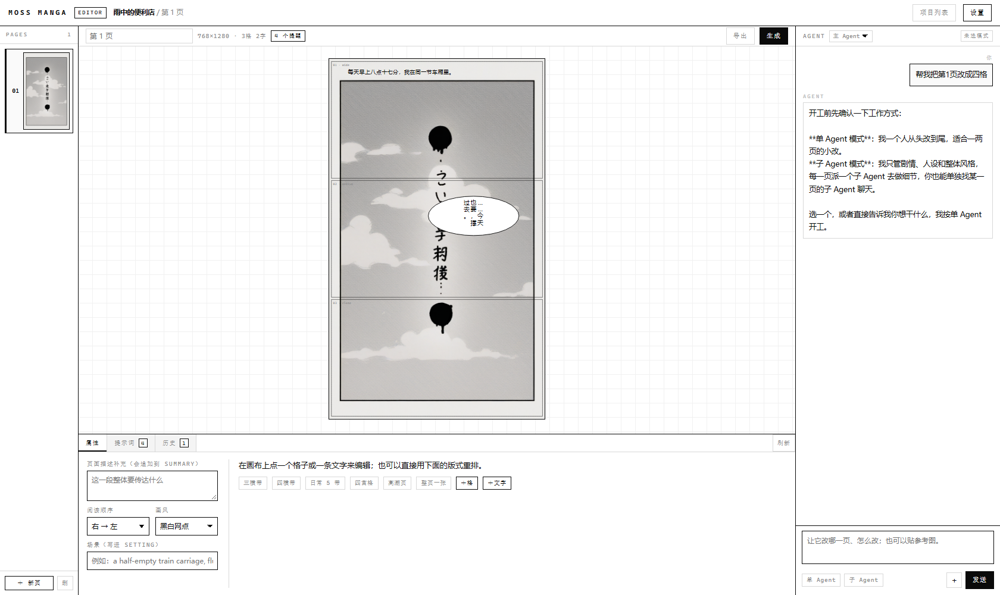

# MOSS 漫画工坊

用 MOSS 模型画漫画分镜的工具：AI 出提示词、按页管理、拖拽调版面、单页重生成、导出长图或 PDF。

**零构建、零安装**：没有打包器、没有 `npm install`、后端只用 Node 内置模块。改完代码刷新浏览器就生效，所以这个项目也适合直接让 AI 帮你改。



---

## 1. 启动

需要 **Node ≥ 22**（用到内置 `fetch`、`WebSocket`）。

```bash
node server.mjs
```

打开 http://127.0.0.1:5123 。换端口：`PORT=5124 node server.mjs`。

第一次进去会把你拉到设置页，填两样东西：

| 项 | 说明 |
|---|---|
| ComfyUI 地址 | 默认 `http://127.0.0.1:8188` |
| 大模型 | 任意 OpenAI 兼容接口：Base URL（填到 `/v1`）+ API Key + 模型名 |

两块都填完点「测试连接」，绿了点「完成设置，开始用」。

想断网也能用，先把前端依赖抓到本地：

```bash
node tools/vendor.mjs
```

之后服务端会自动把 import map 指向 `web/vendor/`。

---

## 2. 怎么用

1. **新建项目** → 选画布（分镜页固定 768×1280）。
2. 左边是页列表，中间是画布，右边是 Agent。
3. 两种干活方式，可以混着用：
   - **自己拖**：拉框、改属性、套版式预设，点「生成」。
   - **让 Agent 改**：在右边说「第三页改成四格，底部放大」，它调工具改数据、编译、生成。
4. 每页的每次生成都会留下一版历史，点缩略图就能切回来。
5. 右上「导出」→ 单张长图（PNG）或 PDF。

---

## 3. 目录

```
core/      纯函数层：文档模型、Moss 编译/反编译、气泡模板、版式预设、校验、占位符
server/    Node 后端：HTTP 路由、文件存储、ComfyUI 客户端、大模型客户端、Agent
web/       前端：Preact + htm，无构建，按页面/组件拆分
workflows/ ComfyUI 工作流（API 格式 JSON + {{占位符}}）
docs/      给人和给 AI 看的文档
tools/     自检、依赖抓取
data/      运行时数据（项目、图片、设置），不进版本库
```

细节见 [docs/ARCHITECTURE.md](docs/ARCHITECTURE.md)。

---

## 4. 换成你自己的工作流（重要）

内置的 `workflows/moss-image.api.json` 只是一个**能跑的通用 SD 图**，不是你的 Moss 工作流。换成你自己的：

1. 在 ComfyUI 里打开你的 Moss 工作流。
2. 菜单 **工作流 → 导出 (API)**，得到 API 格式 JSON。
3. 在设置页「ComfyUI 工作流」里选一个文件，把 JSON 贴进文本框，点保存。
4. 想暴露成界面参数的字段，把值改成 `{{名字}}`，比如：

```json
"6": { "class_type": "CLIPTextEncode", "inputs": { "text": "{{prompt}}", "clip": ["1", 1] } }
```

保存后会自动识别出 `prompt` 这个参数。识别的规则见 [docs/WORKFLOW.md](docs/WORKFLOW.md)。

---

## 5. Agent

- **单 Agent**：一个 Agent 从头改到尾。
- **子 Agent**：主 Agent 只管剧情、人设、整体风格，具体每页派给该页的子 Agent；你也可以单独找某一页的子 Agent 说话。

第一次对话它会先问你选哪种。所有修改都走工具（`update_panel`、`compile_page`、`generate_page`…），不会绕过校验直接写文件。工具清单见 [docs/AGENT.md](docs/AGENT.md)。

---

## 6. 自测

```bash
node core/self-test.mjs   # 编译契约（坐标、字段、气泡文案），25 项
node tools/check.mjs      # 全项目语法检查
```

`core/self-test.mjs` 里那条四格页用例直接取自 Moss 模板文档的示例，跑过就说明坐标换算和产物格式没坏。

---

## 7. 边界

- **单用户本机**：没有账号体系，不要直接暴露到公网。
- **没有局部重绘**：Moss 是整页一次成像，改一处等于整页重跑（这是模型能力边界，不是偷懒）。
- **文字可能画错**：中文渲染不稳定，编辑器给的是「位置 + 字数预算」的约束，不是保证。
- **工作流要自己换**：内置那份只是占位。
